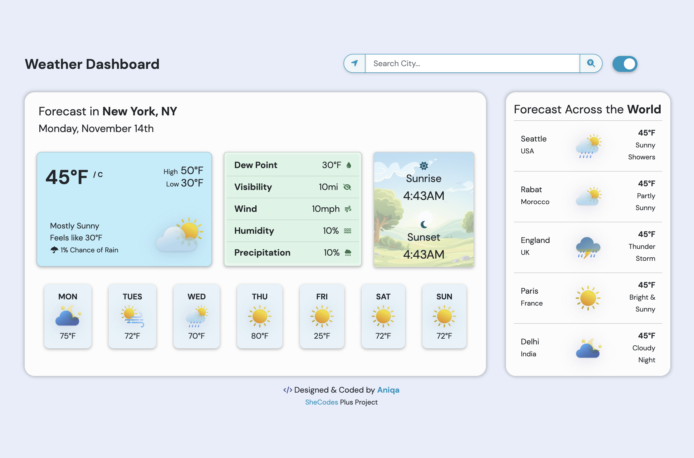
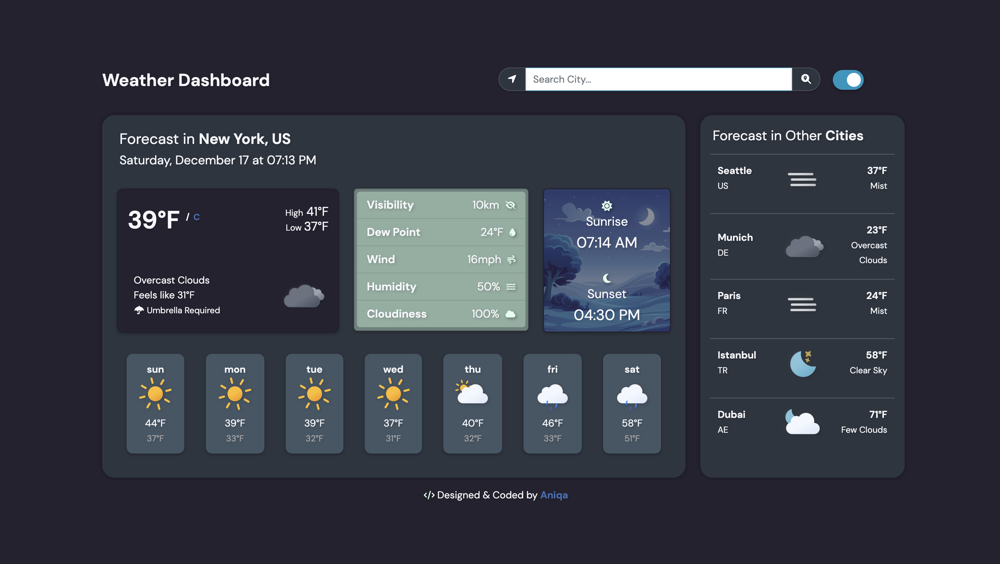

# Weather Dashboard

A light and dark weather dashboard with live conditions and a 7-day forecast for any city, plus current weather in five random cities around the world.

**[Live site](https://weather.aniqa.dev)**

<table>
  <tr>
    <td width="50%"><a href="https://weather.aniqa.dev"></a></td>
    <td width="50%"><a href="https://weather.aniqa.dev"></a></td>
  </tr>
</table>

## Tech

- HTML, CSS and JavaScript, with Bootstrap for layout
- OpenWeather Current Weather and One Call 3.0 APIs
- [Meteocons](https://bas.dev/work/meteocons) animated icons, mapped to OpenWeather conditions in `json/icons.json`
- A service worker and manifest for offline use (PWA)

## Features

- Search over 200,000 cities with accent-insensitive suggestions (`sao paulo` finds São Paulo), navigable with the keyboard
- Use your current location with one tap
- Current conditions (feels like, high and low, humidity, wind, visibility, dew point, cloudiness, sunrise and sunset) and a forecast with the right local day names
- Switch between °F and °C without another API request
- "Forecast in Other Cities" shows five random cities; click one to load it
- Remembers your last city and theme, and works offline after the first visit

## Design

- Light and dark themes built on CSS variables, with a switch in the header
- Animated weather icons and a loading spinner until all data has arrived

## Accessibility

- Labeled search, location, theme and unit controls, with the unit link saying which unit it switches to
- Search suggestions support arrow keys, `Enter` and `Escape`, with visible focus styles
- Errors from search, weather requests and geolocation appear as messages in the search box


## Project structure

- `index.html`: the dashboard markup
- `src/main.js`: everything else, split into `WeatherService` (API calls) and managers for theme, search, time and each weather section
- `css/styles.css`: theme variables and custom styles on top of Bootstrap
- `json/cities/`: 520 search shards; `json/icons.json`: condition-to-icon mapping
- `scripts/build-city-index.py`: builds the shards from OpenWeather's city list
- `service-worker.js` and `manifest.json`: PWA support

## Key concepts

- **Sharded search data.** OpenWeather's city list is 42 MB, so a Python script splits it into 520 shards by the first two letters. The browser only downloads the shard for what you're typing.
- **Coordinates over names.** Suggestions search by latitude and longitude, so cities with the same name resolve correctly, and saved cities keep their coordinates (older saved names still load).
- **Local time from the city.** Times and forecast days use the city's IANA time zone, not your own.
- **Caching that doesn't go stale.** Pages use network-first caching and static assets use stale-while-revalidate, and old caches are cleared on update. Weather responses are never cached.
- **Fewer requests.** Units switch by re-rendering data already loaded, and `icons.json` loads once.

## Setup

Requires an [OpenWeather](https://openweathermap.org/api) API key with access to One Call 3.0. Replace the placeholder in `src/main.js`:

```js
const OPENWEATHER_KEY = 'YOUR_OPENWEATHER_API_KEY_HERE';
```

Then serve the folder with any local server, since the service worker won't register from a file:

```bash
git clone https://github.com/aniqatc/weather.git
cd weather
python3 -m http.server
```

To rebuild the search shards, download [city.list.json.gz](https://bulk.openweathermap.org/sample/city.list.json.gz), unzip it and run `python3 scripts/build-city-index.py city.list.json`.

## Changelog

### October 2026

- Fixed bugs found in a review with Claude: forecast day names, stale cached weather, metric wind speeds, daily highs and lows, and the broken service worker install
- Replaced one 42 MB city file with 520 shards, removed Axios and added keyboard navigation and coordinate-based search

### April 2026

- Upgraded to the OpenWeather One Call 3.0 API

### November 2023

- Added city search suggestions and PWA support, and reorganized the code into a service class and managers

### November 2022

- Initial release
